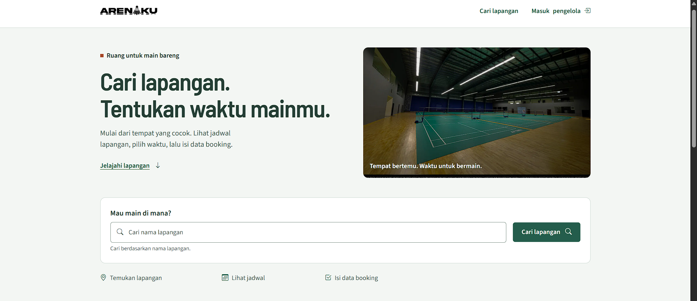
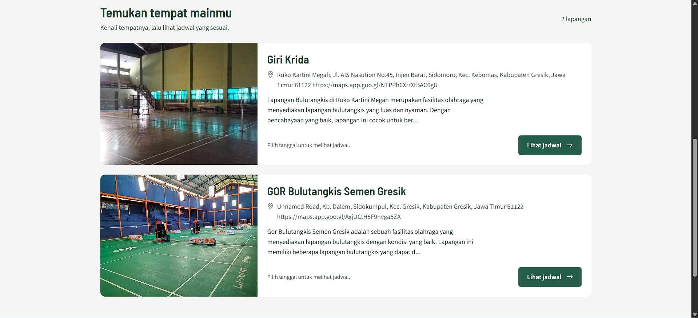
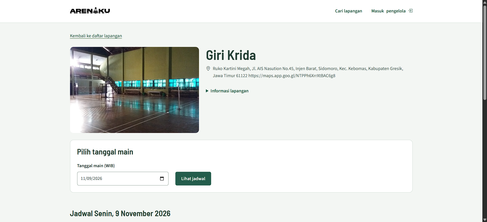
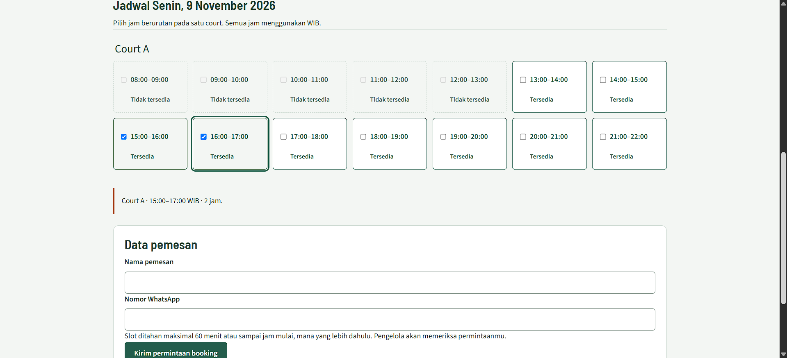

# Arenaku

**Aplikasi web pencarian dan pemesanan lapangan olahraga**

Membantu pengunjung menemukan lapangan dan mengecek jadwal yang tersedia, sekaligus menyediakan dashboard bagi admin dan penjaga untuk mengelola data lapangan, jadwal, serta pemesanan.

---

## Tentang Proyek

**Arenaku** merupakan aplikasi web berbasis Laravel untuk menampilkan informasi tempat olahraga dan mengelola proses pemesanan lapangan. Pengunjung dapat mencari lapangan berdasarkan nama, melihat detail fasilitas, memeriksa ketersediaan jadwal berdasarkan tanggal, dan melanjutkan ke formulir pemesanan.

Di sisi pengelola, aplikasi menyediakan dashboard untuk mengelola lapangan, unit lapangan (*court*), jadwal, pengguna, serta data booking. Proyek ini juga digunakan sebagai media pembelajaran pengembangan aplikasi berbasis **MVC (Model–View–Controller)** dan pemeliharaan aplikasi Laravel.

## Fitur Utama

| Pengguna | Fitur |
| --- | --- |
| **Pengunjung** | Melihat daftar lapangan dan informasi fasilitas; mencari lapangan berdasarkan nama. |
| **Pengunjung** | Membuka detail lapangan dan mengecek ketersediaan jadwal berdasarkan tanggal. |
| **Pengunjung** | Pada venue dengan booking per jam aktif, memilih beberapa slot berurutan pada satu court, mengirim permintaan tanpa login, dan memeriksa status melalui sesi browser pemesanan. |
| **Admin** | Login dan mengelola data lapangan, unit lapangan (*court*), jadwal, booking, dan pengguna. |
| **Penjaga** | Mengelola pengecualian jadwal, penutupan slot, konfirmasi dan pembatalan booking, serta mencatat booking langsung/WhatsApp untuk venue penugasannya. |

## Booking Per Jam

Implementasi booking per jam sudah diterapkan dan pilot **Giri Krida, Court A** telah diaktifkan pada database lokal. Konfigurasi pilot menggunakan jam reguler **08.00–22.00 WIB** dengan rentang pemesanan **14 hari termasuk hari ini**. Aktivasi venue dilakukan per lokasi setelah pemeriksaan data dan konfigurasi operasional.

- Admin mengatur jam reguler, rentang pemesanan, kontak pengelola, dan court aktif. Pengecualian tanggal serta penutupan per court mempertahankan booking dan penutupan yang sudah tercatat.
- Pemesan memilih slot berurutan pada satu court dan tanggal. Waktu serta durasi mengikuti pilihan slot.
- Permintaan menahan seluruh slot sampai dikonfirmasi pengelola. Tenggatnya adalah 60 menit sejak permintaan atau waktu mulai slot pertama, mana yang lebih dahulu.
- Booking pending otomatis kedaluwarsa ketika tenggat tercapai. Slot yang sudah mulai tampil **Tidak tersedia**; slot berikutnya dapat kembali tersedia jika memenuhi aturan operasional.
- Pengelola membatalkan seluruh booking sebelum jam mulai dengan alasan yang tercatat. Riwayat booking dan hubungan slot tetap disimpan.
- Halaman status pemesan terikat pada sesi browser saat pemesanan. Tombol **Perbarui status** menampilkan kondisi terbaru. Status pending menampilkan **Menunggu konfirmasi pengelola**.

Scheduler memeriksa kedaluwarsa setiap menit dan pembentukan slot setiap 15 menit sampai berhasil pada hari tersebut. Pada lingkungan lokal Windows, task memakai peluncur tersembunyi. Komputer, sesi pengguna task, dan MySQL perlu aktif agar proses otomatis berjalan. Konfigurasi database dan Windows Task Scheduler setempat perlu disiapkan tersendiri pada lingkungan lain.

## Dokumentasi

- [Aturan booking per jam](docs/booking-hourly-slots-plan.md)
- [Arsitektur dan integritas data](docs/booking-hourly-architecture.md)
- [Operasional dan pemulihan](docs/operations.md)
- [Penerimaan dan batas pengujian](docs/qa/acceptance.md)

## Tampilan Aplikasi

Antarmuka menggunakan identitas **Arenaku Courtside** pada halaman publik, alur booking, autentikasi, serta dashboard admin dan penjaga. Berikut tampilan halaman publik dan booking per jam yang diambil pada 9 November 2026.

### 1. Beranda dan Pencarian Lapangan

Beranda menyediakan pencarian berdasarkan nama lapangan dan akses untuk menjelajahi venue, melihat jadwal, serta memulai booking.

### 2. Daftar Venue

Daftar venue menampilkan foto, alamat, deskripsi singkat, dan tombol **Lihat jadwal** untuk membuka halaman pemesanan.

### 3. Detail Venue dan Pemilihan Tanggal

Pengunjung dapat melihat informasi venue, memilih tanggal main dalam WIB, lalu menekan **Lihat jadwal** untuk memeriksa slot pada tanggal tersebut.

### 4. Pemilihan Slot dan Data Pemesan

Jadwal menampilkan seluruh slot per court beserta ketersediaannya. Pengunjung memilih beberapa jam berurutan, memeriksa ringkasan waktu dan durasi, lalu mengisi nama serta nomor WhatsApp untuk mengirim permintaan booking.

## Teknologi yang Digunakan

| Bagian | Teknologi |
| --- | --- |
| Backend | PHP 8.2+, Laravel 11 |
| Frontend | Blade, HTML, CSS, JavaScript, Bootstrap 5 publik, Bootstrap 4 / SB Admin 2 dashboard, jQuery dan DataTables |
| Database | MySQL |
| Autentikasi | Laravel UI |
| Asset bundling | Laravel Mix 5 (Webpack) |
| Lingkungan lokal | Laragon (dapat disesuaikan untuk lingkungan PHP lain) |
