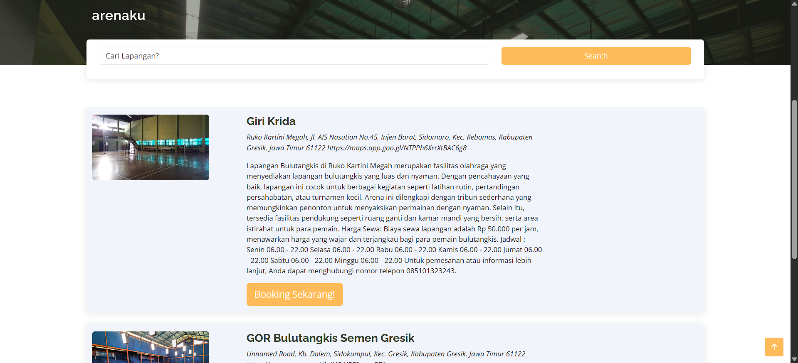
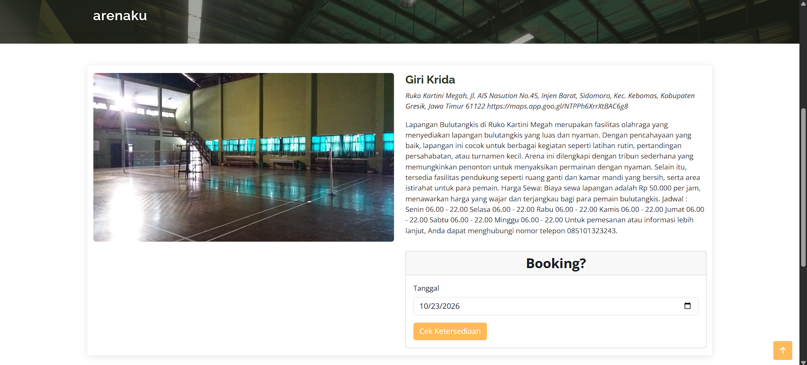

# Arenaku

**Aplikasi web pencarian dan pemesanan lapangan olahraga**

Membantu pengunjung menemukan lapangan dan mengecek jadwal yang tersedia, sekaligus menyediakan dashboard bagi admin dan penjaga untuk mengelola data lapangan, jadwal, serta pemesanan.

---

## Tentang Proyek

**Arenaku** merupakan aplikasi web berbasis Laravel untuk menampilkan informasi tempat olahraga dan mengelola proses pemesanan lapangan. Pengunjung dapat mencari lapangan berdasarkan nama, melihat detail fasilitas, memeriksa ketersediaan jadwal berdasarkan tanggal, dan melanjutkan ke formulir pemesanan.

Di sisi pengelola, aplikasi menyediakan dashboard untuk mengelola lapangan, unit lapangan (*court*), jadwal, pengguna, serta data booking. Proyek ini juga digunakan sebagai media pembelajaran pengembangan aplikasi berbasis **MVC (Model–View–Controller)** dan pemeliharaan aplikasi Laravel.

## Fitur Utama

| Pengguna | Fitur |
| --- | --- |
| **Pengunjung** | Melihat daftar lapangan dan informasi fasilitas; mencari lapangan berdasarkan nama. |
| **Pengunjung** | Membuka detail lapangan dan mengecek ketersediaan jadwal berdasarkan tanggal. |
| **Pengunjung** | Mengisi formulir konfirmasi booking pada jadwal yang tersedia. |
| **Admin** | Login dan mengelola data lapangan, unit lapangan (*court*), jadwal, booking, dan pengguna. |
| **Penjaga** | Mengakses dashboard untuk mengelola data lapangan dan jadwal yang menjadi tanggung jawabnya. |

## Tampilan Aplikasi

### 1. Beranda dan Pencarian Lapangan

Pengunjung dapat melihat daftar lapangan, informasi lokasi dan deskripsi, kemudian menggunakan kolom pencarian atau memilih tombol **Booking Sekarang!** untuk melihat detail lapangan.

### 2. Detail Lapangan dan Cek Ketersediaan

Halaman detail menampilkan foto, lokasi, dan informasi lapangan. Pengunjung dapat memilih tanggal dan menekan **Cek Ketersediaan** untuk melihat jadwal pada tanggal tersebut.

## Teknologi yang Digunakan

| Bagian | Teknologi |
| --- | --- |
| Backend | PHP 8.2+, Laravel 11 |
| Frontend | Blade, HTML, CSS, JavaScript, Bootstrap / template SB Admin 2 |
| Database | MySQL |
| Autentikasi | Laravel UI |
| Asset bundling | Laravel Mix 5 (Webpack) |
| Lingkungan lokal | Laragon (dapat disesuaikan untuk lingkungan PHP lain) |